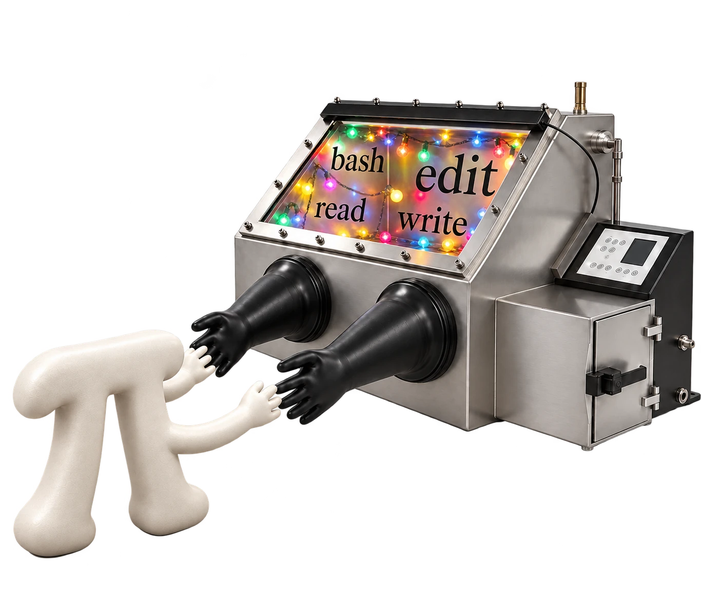

# pi-glovebox



A [Pi](https://github.com/earendil-works/pi) extension that runs the model's `bash`, `read`, `write` and `edit` calls in a sandbox you start, such as [sbox](https://github.com/DavHau/sbox), instead of in Pi's process. The sandbox runs without Pi's config, credentials or session history. They talk over a Unix socket.

Every call becomes one command run by `pi-glovebox-server` inside your sandbox:

| Tool | Command |
|---|---|
| `bash` | `bash -c <command>` in Pi's working directory |
| `read` | `: < file` to check access, `head -c 4100` to detect images with Pi's own detector, `cat` |
| `write` | `mkdir -p`, then `cat > file` with the content on stdin |
| `edit` | `: < file && : >> file` to check access, `cat`, `cat > file` |

Your `!` and `!!` commands run the same way as `bash`. Commands get the server's environment, not Pi's. Aborts and timeouts close the connection, and the server kills the command's process group. Like Pi's own `bash`, a command counts as finished once it has exited and any background processes it started have printed nothing for 100 ms; those processes keep running.

pi-glovebox also blocks calls to tools that would run in Pi's process instead, returning an error the model sees:

- every tool built into Pi, such as `grep`, `find`, `ls` and `codemode`, even if another extension activates it;
- `bash`, `read`, `write` or `edit` when another extension provides it.

## When to use it

Pi sandbox extensions mostly take one of three approaches:

- check tool calls against allow and deny lists, often asking the user, and wrap bash commands in an OS sandbox;
- run the tools in a micro-VM the extension manages;
- run all of Pi, extensions included, in a container.

pi-glovebox separates where Pi runs from where the model's commands run, and leaves the second entirely to you: a bubblewrap or sbox sandbox, a container, a VM, or another machine reached through a forwarded socket. It has no policy and asks no questions, so it also works unattended, and Pi's process, environment, files and session history stay outside whatever you choose.

## Requirements

- Pi 0.85.0 or later.
- Node.js 22 or later for the server, and `bash`, `cat`, `head` and `mkdir` inside the sandbox.
- Pi's working directory must exist at the same path inside the sandbox.

## Install

```bash
pi install npm:pi-glovebox          # or: pi install git:github.com/421anon/pi-glovebox
npm install -g pi-glovebox          # pi-glovebox-server, or: nix-build -E '(import <nixpkgs> { }).callPackage ./. { }'
```

## Use

```bash
SOCKET_DIR=$(mktemp -d)
env -i PATH="$PATH" HOME="$HOME" USER="$USER" sbox --bind "$SOCKET_DIR" "$SOCKET_DIR" -- pi-glovebox-server "$SOCKET_DIR/socket" &
PI_GLOVEBOX_SOCKET="$SOCKET_DIR/socket" pi --no-builtin-tools
```

This sandbox sees the project read-write, `/nix` and the directories on your `PATH` read-only, and little else of the host: not the rest of `$HOME`, host `/tmp`, Pi's processes or the shell's environment. The server is ready once the socket exists.

- `env -i` keeps exported API keys out of the sandbox, since sbox passes its environment through.
- `--no-builtin-tools` leaves Pi's own tools inactive. If pi-glovebox fails to load, Pi has no tools unless another extension activates Pi's own.
- Other extensions, including their tools, run in Pi's process with Pi's environment. Load only extensions you trust, or pass `--no-extensions` and name each with `-e`.
- The bash environment Pi normally sets (`PI_SESSION_ID`, `PI_MODEL`, …) and the `shellPath` and `shellCommandPrefix` settings do not reach the sandbox; the `bash` tool does not mention them to the model.
- Anything that can reach the socket can run commands in the sandbox.
- Pi still reads `AGENTS.md`, skills, extensions and settings from the host. If the model can write them, it can influence later sessions; see Pi's `--no-context-files`, `--no-skills`, `--no-extensions` and `--no-approve`.
- Pi saves truncated bash output under its `TMPDIR`. Mount that directory into the sandbox if the model should read those files.

## Protocol

One connection runs one command. The client sends one line of JSON, `{"argv": [...], "cwd": "/abs/path", "stdin": "optional text"}`. The server answers with frames of a 1-byte type, a 4-byte big-endian length and a payload: type 1 carries output (stdout and stderr as they arrive); type 2 carries the exit code as JSON (`null` if the command was killed by a signal); type 3 carries an error message if the command could not start, such as a missing `cwd`. Either type 2 or type 3 comes last, then the server closes the connection. Closing the connection early, including only its writing side, kills the command's process group, so keep it fully open until the last frame; a malformed request closes it without running anything.

## License

[MIT](LICENSE)
